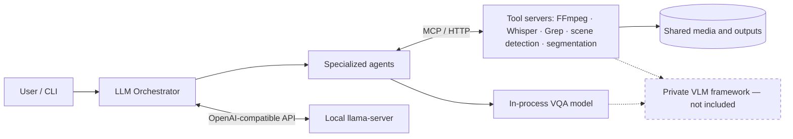

# VideoSearcher — Agentic Video Understanding

**A modular, research-oriented multi-agent system for understanding video and audio using specialized tools, vision-language models, and a local LLM orchestrator.**

Built as a group academic project at **Politecnico di Milano** by **Stefano Garzoni, Daniel Guarnizo, and Leonardo Scappatura**. This repository preserves the available source code, experiment outputs and presentation materials from the July 2026 project.

> **Source snapshot · limited reproducibility.** One underlying vision framework was developed separately and is **not distributed here** for access and intellectual-property reasons. Consequently, the **full VQA/segmentation stack cannot be built from this repository alone**. No missing implementation or working full-system demo is claimed. See [Private components](docs/PRIVATE_COMPONENTS.md) and [Project scope](docs/PROJECT_SCOPE.md).

## At a glance

- **Agent orchestration** using Python, OpenAI Agents SDK, and handoff tools.
- **MCP-based microservices** for video frames, transcription, audio analysis, segmentation, transcript search, scene detection, web search and summarization.
- **Multimodal reasoning** combining a local vision-language model with tools for temporal and textual evidence.
- **LLM benchmarking** across five orchestrator configurations with a 22-scenario × 3-prompt-level suite.
- **Energy-aware evaluation** using CodeCarbon and Bayesian sampling-parameter tuning.

## System architecture



**Representative workflow:** “Find the moment where an aircraft appears and explain what is happening” → frame extraction → VQA or segmentation → final natural-language answer. This is an architectural example, **not a verified demo runnable from the snapshot alone**.

## Research results

The source artifacts document **66 evaluations per model** (22 task scenarios at vague, clear and algorithmic prompt levels). The best **single baseline run** in the supplied comparison is Qwen3.6-35B-A3B, but follow-up repetitions show important stochastic variability; single best scores must **not** be presented as stable averages.

| Orchestrator LLM | Baseline overall pass (single run) | Avg. task latency | Energy per suite (kWh) |
|---|---:|---:|---:|
| Gemma 4 12B | 93.9% | 92.1 s | 0.092779 |
| Gemma 4 E2B | 90.9% | 37.1 s | 0.035274 |
| GPT-OSS 120B | 87.9% | 30.2 s | 0.028289 |
| Qwen3.6 27B | 87.9% | 77.1 s | 0.086534 |
| **Qwen3.6 35B-A3B** | **95.5%** | **32.0 s** | **0.029132** |

*Recorded baseline runs (July 2026), VQA held constant; comparisons depend on specific hardware and inference setup. Source: [`tests/results/markdowns/final_metrics_table.md`](tests/results/markdowns/final_metrics_table.md).*


**Tuning confirmation (two repeats per selected configuration):** Gemma E2B 93.2%, GPT-OSS 120B 86.3%, and Qwen3.6-A3B at its defaults 90.2%. These small samples show why selecting the maximum single trial can be misleading. See [Results and interpretation](docs/RESULTS.md).

## Repository contents

| Location | Contents |
|---|---|
| `agents-container/` | Orchestrator, specialized agents, in-process VQA integration, CLI |
| `tools/` | MCP service implementations and Dockerfiles |
| `local-ai-service/` | Local model launcher / orchestration scripts |
| `tests/` | Scenarios, ground truth, metrics, curated benchmark outputs |
| `scripts/` | Benchmark, energy and hyperparameter tuning scripts |
| `docs/` | Architecture, methodology, limitations, presentations |
| `legacy/` | Older project materials retained for context (not the current runtime) |

## Quick verification — works without GPU

You can inspect the implementation and run **CPU-only metric unit tests** without the private vision framework:

```bash
python -m pip install pytest
python -m pytest -q tests/unit/test_metrics.py
```

**Full stack:** requires the separately maintained VLM framework, local GGUF checkpoints, additional third-party dependencies, an NVIDIA environment and media fixtures. These are **not** delivered in this repository. Do not interpret the existing Docker configurations as a standalone installation. Read [Setup and limitations](docs/SETUP.md), [Private components](docs/PRIVATE_COMPONENTS.md), and [Reproducibility](docs/REPRODUCIBILITY.md).

## Documentation and slides

- [Documentation index](docs/README.md) · [Architecture](docs/ARCHITECTURE.md) · [Orchestrator design](docs/ORCHESTRATOR_DESIGN.md)
- [Benchmark interpretation](docs/RESULTS.md) · [Model comparison](docs/MODEL_COMPARISON.md) · [Bayesian optimization](docs/HYPERPARAMETER_TUNING.md)
- [Vision-language system slides (PDF)](docs/presentations/VideoSearcher_VLM_Interaction.pdf)
- [Benchmark defense slides (PDF)](docs/presentations/VideoSearcher_Benchmark_Defense.pdf) · [Editable PPTX](docs/presentations/VideoSearcher_Benchmark_Defense.pptx)
- [Original detailed technical guide](docs/TECHNICAL_GUIDE.md) (historical commands; may require missing private dependencies)

## Contributors and attribution

**Stefano Garzoni · Daniel Guarnizo · Leonardo Scappatura** — group project, Politecnico di Milano. The **contribution of each individual has not been inferred from filenames or slide authorship**. The externally maintained VLM testing framework is **not claimed as original work by this repository's maintainers**. See [scope and attribution](docs/PROJECT_SCOPE.md).

**Licensing:** No open-source license is granted by this snapshot. All underlying rights remain with their respective holders. **Private repository ≠ permission to redistribute**; review rights and teammate consent before changing visibility.
