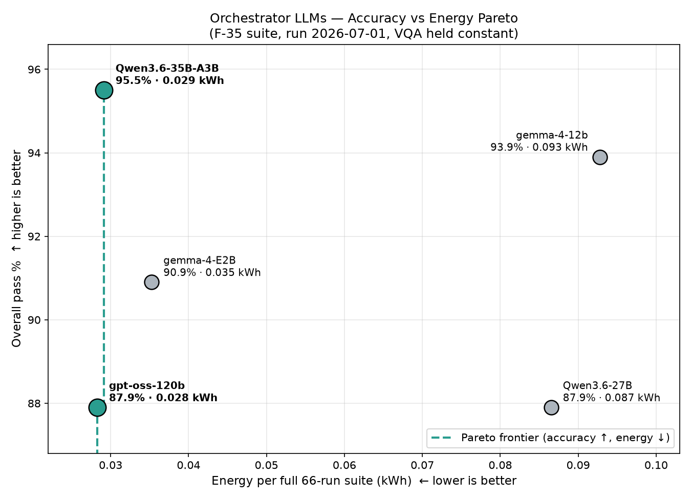

# Experimental results — interpretation and limits

Results below are **extracted from the supplied July 2026 artifacts**; no new model experiments were executed when curating this repository. The figures are tied to the documented hardware, specific GGUF weights, fixed Phi-4 VQA component and scenario set.

## Five-model baseline (single run per model)

The model comparison used 22 scenarios × 3 prompt styles = 66 tasks per model and recorded 14 metrics spanning routing, answer quality, robustness, latency, decode throughput, and energy. The figures below are selected columns from [`final_metrics_table.md`](../tests/results/markdowns/final_metrics_table.md).

| Model | Overall | Handoff | Latency (s/task) | Energy (kWh/suite) | Passes / kWh |
|---|---:|---:|---:|---:|---:|
| Gemma 4 12B | 93.9% | 97.0% | 92.1 | 0.092779 | 668.3 |
| Gemma 4 E2B | 90.9% | 93.9% | 37.1 | 0.035274 | 1701.0 |
| GPT-OSS 120B | 87.9% | 87.9% | 30.2 | 0.028289 | 2050.3 |
| Qwen3.6 27B | 87.9% | 89.4% | 77.1 | 0.086534 | 670.3 |
| Qwen3.6 35B-A3B | **95.5%** | 95.5% | 32.0 | 0.029132 | **2162.6** |

**Caution:** '95.5%' is the **observed maximum baseline run**, not a demonstrated population mean. The `Passes/kWh` metric uses the experiment-specific energy measurement methodology; it does not directly imply a general-purpose energy rating.

## Bayesian tuning and confirmation

The optimizer explores the sampling settings **temperature**, **top-p**, and **top-k** using an expected-improvement-guided Bayesian search. A separate confirmation stage repeated selected configurations **twice** per model.

| Model, selected settings | Best observed single run | Repeat 1 | Repeat 2 | Confirmation mean |
|---|---:|---:|---:|---:|
| Gemma 4 E2B — `t0.40/p0.65/k10` | 95.5% | 93.9% | 92.4% | **93.2%** |
| GPT-OSS 120B — `t0.30/p0.98/k20` | 92.4% | 84.8% | 87.9% | **86.3%** |
| Qwen3.6 35B-A3B — **default** `t0.80/p0.95/k40` | 95.5% | 89.4% | 90.9% | **90.2%** |

The last row is **a confirmation of the baseline/default settings**, not a tuning winner; the original `VideoSearcher_final_defense.pdf` in the delivery archive wrongly described the defaults as `t1.00/p0.95/k20`. This repository ships a PDF regenerated from the supplied editable PowerPoint, which correctly says *keep defaults*. The correct default sampling flags are `t0.80/p0.95/k40`, as verified by [`tests/results/tuning/confirmations.json`](../tests/results/tuning/confirmations.json).

Two repeats provide **limited** uncertainty information. They demonstrate winner-selection bias and stochastic variability; they do not establish confidence intervals or statistically significant model rankings. A stronger experiment would use repeated trial evaluations or a noise-aware Gaussian-process model.

## Source materials

- [`tests/results/markdowns/final_metrics_table.md`](../tests/results/markdowns/final_metrics_table.md) — complete comparative table.
- [`tests/results/tuning/`](../tests/results/tuning/) — curated search history and confirmation record.
- [`docs/HYPERPARAMETER_TUNING.md`](HYPERPARAMETER_TUNING.md) — methodology and caveats.
- [`docs/MODEL_COMPARISON.md`](MODEL_COMPARISON.md) — evaluation definitions.
- [`docs/presentations/`](presentations/) — defense and system presentation.

## Reproducibility

The original setup required external GPU hardware, local LLM weights, private VLM source, fixtures and specialized services. This export does not suffice to rerun the full benchmark, and the results are historical measurements. See [Reproducibility](REPRODUCIBILITY.md).
